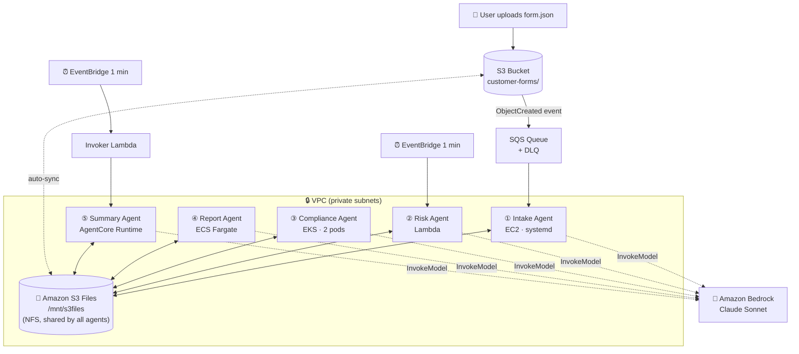

# 🧠 AWS S3 Multi-Agent Pipeline (CDK)

> Five AI agents on five AWS compute services, working together through one shared file system.

A hands-on **AWS CDK (Python)** project. It builds a 5-stage **document-intelligence pipeline**: a customer form goes in, and a risk-scored, compliance-checked executive summary comes out. Each stage is a separate AI agent powered by **Claude on Amazon Bedrock**, built with the [Strands Agents](https://github.com/strands-agents/sdk-python) SDK.

What makes it different: **the agents never call each other.** They coordinate only by reading and writing files in one shared folder (`/mnt/s3files`), backed by **Amazon S3 Files**.

Based on the AWS blog post *"Orchestrating multi-agent AI architectures with Amazon S3 Files"*.

---

## 📑 Table of contents

- [Why this project exists](#-why-this-project-exists)
- [Architecture](#-architecture)
- [The five agents](#-the-five-agents)
- [How the agents talk: the shared file system](#-how-the-agents-talk-the-shared-file-system)
- [Why only some agents have a Dockerfile](#-why-only-some-agents-have-a-dockerfile)
- [Infrastructure stacks](#-infrastructure-stacks)
- [Tech stack](#-tech-stack)
- [Repository structure](#-repository-structure)
- [Quick start](#-quick-start)
- [Testing the pipeline](#-testing-the-pipeline)
- [Cost warning](#-cost-warning)
- [Security notes](#-security-notes)
- [Known limitations](#-known-limitations)
- [Troubleshooting](#-troubleshooting)
- [Ideas for improvement](#-ideas-for-improvement)

---

## 🎯 Why this project exists

This is a **learning lab**, not a production template. It deliberately uses **every major AWS compute option** so you can compare them side by side in one working system:

| You want to learn... | Look at |
|---|---|
| Long-running workers on a VM | Stage 1, **EC2** + systemd |
| Scheduled serverless functions | Stage 2, **Lambda** |
| Kubernetes deployments and shared volumes | Stage 3, **EKS** |
| Serverless containers | Stage 4, **ECS Fargate** |
| AWS's managed AI-agent hosting | Stage 5, **Bedrock AgentCore Runtime** |
| Event-driven triggers | **S3 → SQS** and **EventBridge** schedules |
| Infrastructure as code | **AWS CDK** in Python |

A real project would usually pick one or two of these. Running all five shows the trade-offs between them.

---

## 🏗 Architecture



### Data flow through the folders

```
customer-forms/  ──①──▶  intake/  ──②──▶  analyzed/  ──③──▶  validated/  ──④──▶  reports/ + documents/  ──⑤──▶  summaries/
   (raw JSON)        (metadata)      (risk score)      (PASS/FAIL)         (JSON + .docx)            (exec summary)
```

Each folder is the **output of one agent and the inbox of the next**.

---

## 🤖 The five agents

| # | Agent | Compute | Trigger | Reads | Writes | What the LLM does |
|---|---|---|---|---|---|---|
| 1 | **Intake** | EC2 `t3.small` (systemd service) | SQS long-poll | `customer-forms/*.json` | `intake/doc-<id>.json` | Extracts metadata, priority (high/medium/low), flags, key entities |
| 2 | **Risk** | Lambda (Python 3.12, 2 GB) | EventBridge, every 1 min | `intake/` | `analyzed/analysis-<id>.json` | Risk score 1-10, risk factors, flags like `HIGH_VALUE`, `LONG_TERM` |
| 3 | **Compliance** | EKS 1.30, 2 replicas on `t3.medium` | Polls every 10 s | `analyzed/` | `validated/compliance-<id>.json` | `PASS` / `FAIL` / `REVIEW_REQUIRED`, violations, score 0-100 |
| 4 | **Report** | ECS Fargate (1 vCPU / 2 GB) | Polls every 15 s | `validated/` | `reports/report-<id>.json` and `documents/report-<id>.docx` | Executive report, action items, high-risk items |
| 5 | **Summary** | Bedrock AgentCore Runtime | EventBridge → Invoker Lambda, every 1 min | all of `reports/` | `summaries/summary-<batch>.json` | Batch-level executive summary |

### Shared message format

Every stage writes the same JSON "envelope", so any agent can read any other agent's output:

```json
{
  "id": "0001",
  "stage": "analyzed",
  "type": "loan_application",
  "content": { "...": "LLM output for this stage" }
}
```

### Avoiding duplicate work

Each stage has its own simple way to avoid processing a document twice:

- **Intake / Risk / Summary:** skip the document if the output file already exists.
- **Compliance (2 replicas):** an atomic *claim file*, `os.open(..., O_CREAT | O_EXCL)` in `.claims-eks/`. Only one pod can create it, so only that pod processes the document.
- **Report:** keeps a list of already-processed files in `.processed-ecs.json`.

---

## 📁 How the agents talk: the shared file system

**Amazon S3 Files** lets you mount an S3 bucket as a normal **NFS file system**. To every agent, `/mnt/s3files` is just a folder, so plain `open()`, `os.listdir()` and `json.dump()` calls are enough. No SDK calls or message brokers are needed between stages.

```
          ┌──────────── /mnt/s3files ────────────┐
EC2 ──────┤                                      │
Lambda ───┤   same files, seen by everyone,      ├──── synced ────▶  S3 bucket
EKS pods ─┤   close-to-open NFS consistency      │   (≈60 s after
ECS task ─┤                                      │    writes stop)
AgentCore ┤                                      │
          └──────────────────────────────────────┘
```

How each service connects to it:

| Service | Mount method |
|---|---|
| EC2 | `mount -t s3files` via `amazon-efs-utils`, added to `/etc/fstab` |
| Lambda | `filesystem=` setting through the **access point** |
| EKS | **EFS CSI driver** → `PersistentVolume` (ReadWriteMany) → `PersistentVolumeClaim` |
| ECS Fargate | `S3FilesVolumeConfiguration` on the task definition, through the access point |
| AgentCore | `filesystemConfigurations` on the runtime, through the access point |

**Why this design is useful:**
- ✅ **Loose coupling.** Any stage can be replaced, scaled or redeployed without touching the others.
- ✅ **Easy debugging.** `ls` and `cat` show the exact state of the pipeline.
- ✅ **Persistence.** Everything ends up in S3 for free.
- ✅ **Mixed compute.** VMs, functions, pods and managed runtimes all share data the same way.

**Trade-off:** stages poll on intervals of 10 s to 1 min, so end-to-end processing takes a few minutes. It is not instant.

---

## 🐳 Why only some agents have a Dockerfile

This is a common question. Whether an agent has a Dockerfile depends on **what its compute service accepts**:

| Agent | Dockerfile? | Why |
|---|---|---|
| ① EC2 Intake | ❌ | A full Linux VM. A boot script (user data) installs Python, unzips the code and runs it as a `systemd` service. |
| ② Lambda Risk | ❌ | Lambda provides the Python runtime. You supply code plus `requirements.txt`, and CDK's `PythonFunction` bundles it. |
| ③ EKS Compliance | ✅ | Kubernetes **only runs container images**. |
| ④ ECS Report | ✅ | Fargate **only runs container images**. It also installs `python-docx` for Word output. |
| ⑤ AgentCore Summary | ✅ | AgentCore Runtime **only runs container images**. It also installs `bedrock-agentcore` for the `@app.entrypoint` wrapper. |

At `cdk deploy` time, CDK's `DockerImageAsset` **builds each image locally, pushes it to Amazon ECR**, and passes the image URI to the service. That is why Docker must be running when you deploy.

---

## 🧱 Infrastructure stacks

The CDK app (`cdk-infra/app.py`) is split into **7 independent stacks**, so you can deploy and debug one stage at a time:

```
S3MultiAgent-Network           VPC (2 AZs, 1 NAT gateway) + NFS security group (port 2049)
        │
S3MultiAgent-Storage           S3 bucket (versioned) · S3 Files FS · mount targets · access point (UID 1000) · SQS + DLQ
        │
        ├── S3MultiAgent-Ec2Intake          Stage 1
        ├── S3MultiAgent-LambdaRisk         Stage 2
        ├── S3MultiAgent-EksCompliance      Stage 3   (optional: DEPLOY_EKS=false)
        ├── S3MultiAgent-EcsReport          Stage 4
        └── S3MultiAgent-AgentCoreSummary   Stage 5   (optional: DEPLOY_AGENTCORE=false)
```

---

## 🛠 Tech stack

| Layer | Technology |
|---|---|
| Infrastructure as code | AWS CDK v2 (Python) |
| AI agents | [Strands Agents](https://github.com/strands-agents/sdk-python) |
| LLM | Claude Sonnet on Amazon Bedrock (`us.anthropic.claude-sonnet-4-6`, configurable via `MODEL_ID`) |
| Shared storage | Amazon S3 + Amazon S3 Files (NFS) |
| Compute | EC2 · Lambda · EKS · ECS Fargate · Bedrock AgentCore Runtime |
| Messaging and scheduling | S3 event notifications · SQS (with DLQ) · EventBridge |
| Containers | Docker → Amazon ECR |
| Language | Python 3.12 |

---

## 📂 Repository structure

```
aws-s3-multi-agent-cdk/
├── README.md                          ← you are here (project overview)
└── cdk-infra/
    ├── README.md                      ← detailed deploy / operate / teardown guide
    ├── app.py                         ← wires all 7 stacks together
    ├── cdk.json
    ├── requirements.txt
    ├── stacks/
    │   ├── network_stack.py
    │   ├── storage_stack.py
    │   ├── ec2_intake_stack.py
    │   ├── lambda_risk_stack.py
    │   ├── eks_compliance_stack.py
    │   ├── ecs_report_stack.py
    │   └── agentcore_summary_stack.py
    └── agents/
        ├── intake_ec2/intake_agent.py
        ├── risk_lambda/handler.py + requirements.txt
        ├── compliance_eks/compliance_agent.py + Dockerfile
        ├── report_ecs/report_agent.py + Dockerfile
        └── summary_agentcore/summary_agent.py + Dockerfile
            └── invoker/invoker.py     ← tiny Lambda that triggers AgentCore
```

---

## 🚀 Quick start

> The full step-by-step guide is in **[`cdk-infra/README.md`](cdk-infra/README.md)**. This is the short version.

### Prerequisites

- An AWS account with the CLI configured (`aws sts get-caller-identity`)
- Node.js and the CDK CLI: `npm install -g aws-cdk`
- Python 3.12+
- **Docker running**, because container images are built at deploy time
- **Bedrock model access** enabled for Claude Sonnet in your region
- A region where **Amazon S3 Files** is available (defaults to `us-east-1`)

### Deploy

```bash
cd cdk-infra
python -m venv .venv
source .venv/bin/activate        # Windows: .venv\Scripts\activate
pip install -r requirements.txt

cdk bootstrap aws://<ACCOUNT_ID>/us-east-1

# Recommended first run: skip the two slowest and most expensive stages
DEPLOY_EKS=false DEPLOY_AGENTCORE=false cdk deploy --all

# Then add them one at a time
cdk deploy S3MultiAgent-EksCompliance
cdk deploy S3MultiAgent-AgentCoreSummary
```

### Tear down

```bash
cdk destroy --all
```

The bucket uses `RemovalPolicy.DESTROY` with `auto_delete_objects`, so **all data is deleted** on teardown.

---

## 🧪 Testing the pipeline

```bash
BUCKET=$(aws cloudformation describe-stacks --stack-name S3MultiAgent-Storage \
  --query "Stacks[0].Outputs[?OutputKey=='BucketName'].OutputValue" --output text)

cat > form.json <<'EOF'
{
  "document_type": "loan_application",
  "content": {
    "applicant": "Jane Doe",
    "amount": 250000,
    "term_years": 30,
    "notes": "Standard fixed-rate mortgage application."
  }
}
EOF

aws s3 cp form.json "s3://$BUCKET/customer-forms/doc-0001.json"
```

Watch it move through the stages from the EC2 instance (via SSM, no SSH key needed):

```bash
aws ssm start-session --target <IntakeInstanceId>
watch -n 5 'ls -la /mnt/s3files/{intake,analyzed,validated,reports,documents,summaries}'
```

Or follow the logs:

```bash
aws logs tail /aws/lambda/<RiskFunctionName> --follow
```

Expect a few minutes end to end, because of the polling intervals.

---

## 💸 Cost warning

**This lab is not cost-optimized.** Resources keep running, and billing, until you destroy them. The main ongoing costs are:

| Resource | Why it costs money |
|---|---|
| NAT Gateway | Hourly charge plus data processing |
| EKS control plane | Hourly charge per cluster |
| EKS nodes (2× `t3.medium`) | Always on |
| EC2 `t3.small` | Always on |
| ECS Fargate task | Always on (1 vCPU / 2 GB) |
| Lambda + EventBridge | Runs every minute, even when there is no work |
| Bedrock | Per-token charges for every agent call |

💡 Use `DEPLOY_EKS=false DEPLOY_AGENTCORE=false` to cut costs, and **always run `cdk destroy --all` when you're done.** Check the [AWS Pricing Calculator](https://calculator.aws/) for your region.

---

## 🔐 Security notes

Reasonable for a lab, but **tighten these before using real data**:

- **Bedrock permissions** use `resources=["*"]`. Scope them to specific model ARNs.
- **EKS pods use the node IAM role.** Switch to IRSA or EKS Pod Identity for per-pod permissions.
- **Pipeline directories are `chmod 777`**, so the UID-1000 access point can write next to root-owned EC2 writes.
- **The bucket auto-deletes on teardown.** Change `RemovalPolicy` for anything you care about.
- ✅ Already in place: private subnets, S3 public access blocked, SSL enforced, IMDSv2 required, SSM access instead of SSH.

---

## ⚠️ Known limitations

- **S3 Files and AgentCore are new services.** Some CDK constructs don't support them yet, so the code uses workarounds:
  - **ECS:** `S3FilesVolumeConfiguration` is patched in with `add_property_override`.
  - **AgentCore:** the runtime is created with an `AwsCustomResource` that calls `bedrock-agentcore-control` directly.
  - **EKS:** assumes the `AmazonS3FilesCSIDriverPolicy` managed policy exists in your account.
- **LLM output is parsed with `json.loads`**, so a response that isn't valid JSON fails that document. Failures are logged and skipped.
- **The Risk Lambda processes documents one after another** in a single run, with a 10-minute timeout.
- **No retry or dead-letter handling between stages** after intake. A failed document just stays in its inbox folder.
- **Polling-based**, so not suitable for low-latency use cases.

---

## 🩺 Troubleshooting

| Symptom | Likely cause / fix |
|---|---|
| `AccessDeniedException` from Bedrock | Enable model access in the Bedrock console for this region |
| `cdk deploy` fails while building assets | Docker isn't running |
| Nothing appears in `intake/` | Check `sudo systemctl status intake-agent` and `journalctl -u intake-agent` on EC2. Confirm the file key ends in `.json` under `customer-forms/` |
| `mount` fails or hangs | Security group must allow TCP 2049. Mount targets must be in the same private subnets |
| Lambda times out | VPC/NAT routing problem, or too many files in one run |
| VPC won't delete on teardown | Leftover ENIs from Lambda, ECS or AgentCore. Wait, then destroy stacks one by one in reverse order |
| Files visible on the mount but not in the S3 console | Normal. Sync to S3 happens after about 60 s without writes |

---

## 💡 Ideas for improvement

- [ ] Use structured output or JSON-schema validation for LLM responses
- [ ] Add per-stage error folders (`failed/`) and retry logic
- [ ] Replace polling with event triggers where supported
- [ ] Use IRSA or Pod Identity for EKS and least-privilege Bedrock policies
- [ ] Add a CloudWatch dashboard with per-stage throughput and errors
- [ ] Add unit tests with mocked Bedrock, plus CDK snapshot tests
- [ ] Add a CI pipeline (GitHub Actions) running `cdk synth` and linting

---

## 🙏 Credits

- Architecture from the AWS blog post *"Orchestrating multi-agent AI architectures with Amazon S3 Files"*
- Built with [AWS CDK](https://aws.amazon.com/cdk/), [Strands Agents](https://github.com/strands-agents/sdk-python) and [Amazon Bedrock](https://aws.amazon.com/bedrock/)

> ⭐ If this helped you understand multi-agent architectures on AWS, consider starring the repo!
